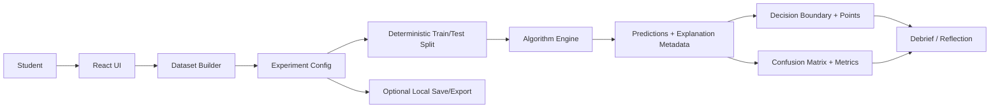

# System Architecture

## MVP architecture

The initial experience is fully client-side. This makes the demo fast to try and avoids sending student-created data to a server.



## Responsibilities

- **UI shell:** screen layout, feature controls, grade-band mode.
- **Dataset builder:** point creation, label assignment, seeded generators, validation.
- **Experiment manager:** immutable/versioned config, dirty state, rerun requirements.
- **Split module:** stable train/test assignment by seed, stratification if/when appropriate.
- **Algorithm engine:** pure deterministic functions for training/prediction.
- **Visualization layer:** point canvas, boundary heatmap/grid, neighbor links, decision tree path.
- **Evaluation module:** metrics computed from `y_true` and held-out predictions; no hidden re-training.
- **Explainability metadata:** neighboring samples or tree path from the exact trained model.
- **Local persistence:** opt-in experiment export and recent experiment summary.

## Boundary rules

- Algorithm modules must not import React, Canvas, DOM, local storage, or plotting libraries.
- Visualization must not implement its own alternate prediction rules.
- Evaluation must accept true labels and predictions and return metrics; it must not train a model.
- The split module must be independently testable.
- A dirty experiment cannot show stale metrics as if they belong to the current data. Mark results stale and disable comparison until rerun.

## Future optional service

Only add FastAPI/Python/scikit-learn when an advanced feature genuinely needs it. Keep the contract explicit: request includes dataset/model configs, response includes model version, metrics, predictions and warnings. Enforce payload caps, rate limits, and no persistent storage by default. Never place secrets in frontend environment variables.

## Suggested TypeScript interfaces

```ts
export type ClassId = string;
export interface Point2D {
  id: string;
  x: number;
  y: number;
  label: ClassId;
  split?: 'train' | 'test';
}
export interface KnnConfig {
  algorithm: 'knn';
  k: number;
  distance: 'euclidean';
  tieBreak: 'nearest-then-class-id';
}
export interface ExperimentConfig {
  schemaVersion: string;
  id: string;
  seed: number;
  featureNames: [string, string];
  classNames: ClassId[];
  points: Point2D[];
  split: { strategy: 'random' | 'stratified'; testRatio: number; seed: number };
  model: KnnConfig;
}
```

Refine names and unions during implementation. Avoid typing all model settings as a loosely structured object.

## Performance strategy

- MVP datasets should be small (suggested limit: 1,000 points for general editing, 300 in guided activities; tune after profiling).
- Compute boundary predictions in a worker if interaction begins to block the UI.
- Throttle slider-triggered re-training and display a “recompute” action if real-time computation becomes too costly.
- Render visual layers independently to avoid redrawing the entire UI on every pointer move.
- Make point selection and label shapes accessible through a companion list/table.
